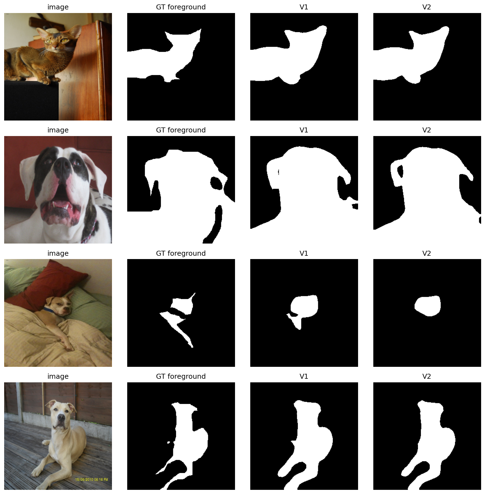
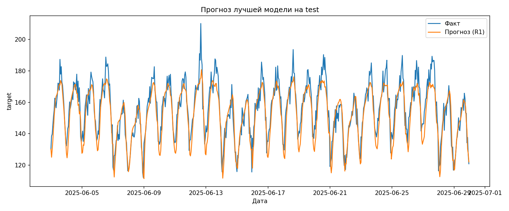

# AI Engineering Lab

Я делал эти работы на курсе «Инженерия искусственного интеллекта» в РТУ МИРЭА. Начал с NumPy и анализа таблиц, затем написал небольшой EDA-сервис, обучал модели на PyTorch и разбирался с обработкой текста и поиском по документам.

В [homeworks/](homeworks/) я собрал ноутбуки, код, отчёты и результаты экспериментов. В [project/](project/) остался шаблон итогового проекта, его я пока не заполнил.

## Что я сделал

- В [HW01](homeworks/HW01/HW01.ipynb) и [HW02](homeworks/HW02/HW02.ipynb) работал с NumPy, pandas и Matplotlib: обрабатывал таблицы, считал статистики и строил графики.
- В [HW03](homeworks/HW03/eda-cli/) написал CLI для анализа CSV на Typer. В [HW04](homeworks/HW04/eda-cli/) добавил HTTP API на FastAPI, отчёты о пропусках и качестве данных, графики и тесты на pytest.
- В [HW05](homeworks/HW05/HW05.ipynb) и [HW06](homeworks/HW06/report.md) сравнивал классификаторы, деревья и ансамбли в scikit-learn. Подбирал параметры на обучающей выборке, результат оценивал на отдельной тестовой. В [HW07](homeworks/HW07/report.md) изучал K-Means, DBSCAN, агломеративную кластеризацию и PCA.
- В [HW08-09](homeworks/HW08-09/report.md) писал цикл обучения MLP на PyTorch и сравнивал конфигурации. В [HW10-11](homeworks/HW10-11/report.md) занимался классификацией SVHN и сегментацией Oxford-IIIT Pet с PyTorch и torchvision. В [HW12](homeworks/HW12/report.md) сравнивал базовые модели прогноза временного ряда с GRU.
- В [HW13](homeworks/HW13/report.md) использовал Hugging Face Transformers и Datasets, изучал токенизацию и дообучал DistilBERT для распознавания шести классов эмоций.
- В [HW14](homeworks/HW14/report.md) собрал поиск по документации SQLite: разбивка на фрагменты, TF-IDF, индекс FAISS, оценка поиска и обновление базы. Ответ я собирал из найденных фрагментов, генеративную LLM в этой работе не подключал.

В отчётах я сохранил условия экспериментов и метрики. Они относятся к выбранным данным и разбиению выборок, а не к качеству моделей на любых задачах.

## Примеры результатов

Сегментация Oxford-IIIT Pet:



Прогноз временного ряда на тестовом участке:



## Как запустить EDA-сервис

Нужны Python 3.11+ и `uv`. Из корня репозитория:

```bash
cd homeworks/HW04/eda-cli
uv sync --locked
uv run eda-cli overview data/example.csv
uv run pytest -q
uv run uvicorn eda_cli.api:app --reload --host 127.0.0.1 --port 8000
```

Документация API откроется на <http://127.0.0.1:8000/docs>. Я добавил `GET /health`, `POST /quality`, `POST /quality-from-csv` и `POST /quality-flags-from-csv`. Оценка качества CSV основана на простых правилах и помогает заметить проблемы в данных, но не заменяет их анализ.

[Остальные команды CLI и API](homeworks/HW04/eda-cli/README.md).

## Как открыть остальные работы

Ноутбуки можно открыть в Jupyter. Зависимости, данные и порядок запуска нужно смотреть в конкретной работе. Для некоторых экспериментов потребуется скачать датасет или модель и запустить обучение.

Общее окружение для всех ноутбуков я не собирал. У HW03 и HW04 есть свои `pyproject.toml` и `uv.lock`. Пустой `project/requirements.txt` относится к шаблону итогового проекта и не устанавливает зависимости домашних работ.

## Материалы курса

Я, Дмитрий Сломов, выполнял эти работы в группе ИКБО-27-22. За основу взял учебный шаблон курса. Исходную памятку и требования преподавателя сохранил в [docs/course-template.md](docs/course-template.md), правила работы с данными и секретами находятся в [SECURITY.md](SECURITY.md).
